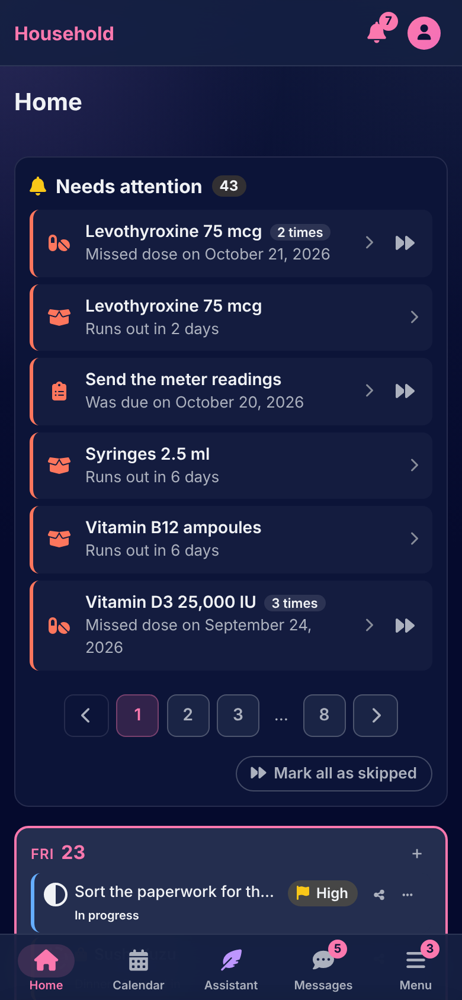
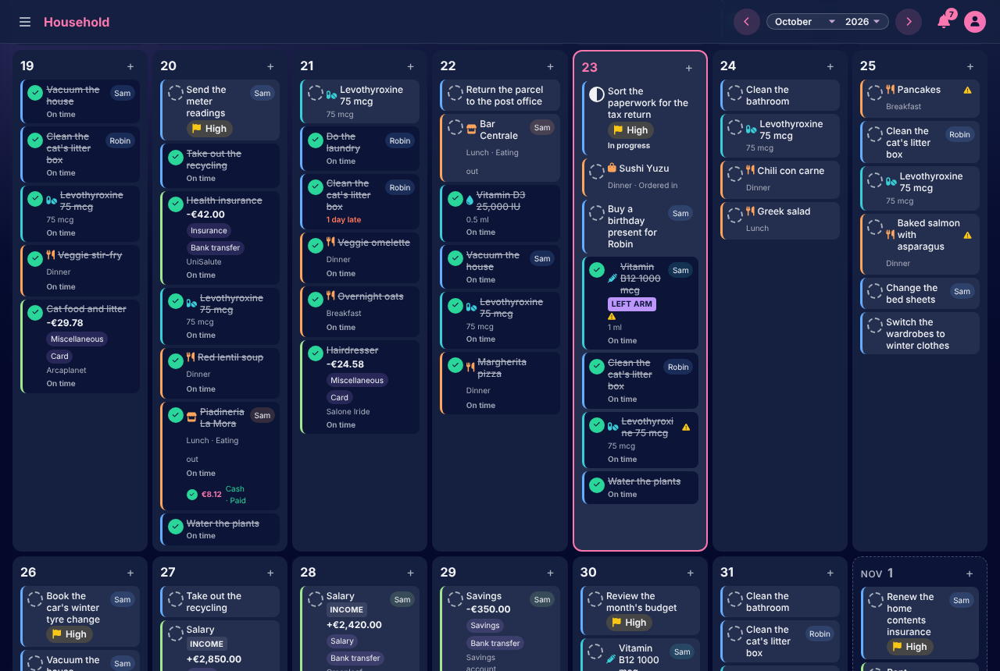
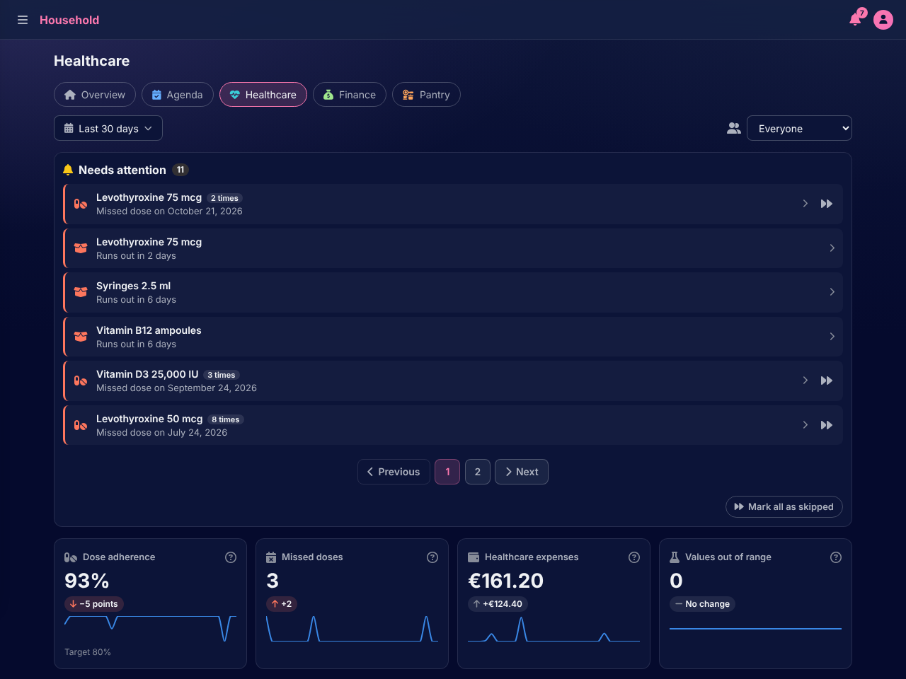

# Household

Household is a web app for running a home together. One calendar holds the tasks, the appointments, the medications, the meals, the lab results and the payments. Around it are the pantry and the grocery lists, the bookshelf, the household's files, the messages between housemates, and an assistant that files what you tell it. On a phone, install it as a web app.

**[Try the live demo](https://juume.site/demo).** It is a household of three people with six months of history. Pick one of them and you are in, with no account. Everyone who visits shares it, and it is rebuilt every night.

<table>
  <tr>
    <td></td>
    <td></td>
  </tr>
  <tr>
    <td></td>
    <td></td>
  </tr>
</table>

## What it does

- **One calendar for everything planned.** A task due on Friday, a medication with breakfast and at bedtime, the rent on the first of the month, dinner with friends: each is a series with its days. A day can be done, skipped (and why) or changed alone, or the whole series changed from then on.
- **A home page per section:** Agenda, Healthcare, Finance, Pantry. Each has what needs attention today, and its statistics over a period and per person.
- **One household, several people.** Each person's things are their own until they share one with a housemate. Two housemates can link their calendars, and each chooses, per kind of item, what the other may see, change, add or delete, or must ask first.
- **Messages** between housemates, live, with photos and reactions.
- **Files of any size,** uploaded in chunks that resume after a dropped connection. They are shared with a housemate, or by a public link with an expiry, a download limit and a password.
- **A bookshelf** filled by scanning a book's barcode.
- **An assistant.** "I paid the plumber 80 in cash", "Cobalamin 250, the test was today", or a photo of a lab report, and the records are saved, with an Undo button on each change; a deletion, or a change a housemate would see, waits for your OK first. It works with a small model running locally, or with Anthropic's or OpenAI's.

Everything on screen is in English and Italian. The [guide](docs/guide/README.md) has a page for each part of the app.

## Documentation

[The documentation](docs/README.md) starts from what you came to do:

- **Using the app:** [the guide](docs/guide/README.md), a page for each part of it.
- **Running a copy:** [self-hosting](docs/self-hosting.md), from a release.
- **Working on the code:** [CONTRIBUTING.md](CONTRIBUTING.md), [STYLE.md](STYLE.md) and [the architecture](docs/architecture/README.md).

## Running it for your household

One machine with Docker is enough. The installer downloads a release, asks where the files go and how people reach the app, and starts it:

```sh
curl -fsSLO https://github.com/adev0x3b/household/releases/latest/download/install.sh
less install.sh
sh install.sh
```

It ends with the address to open and a one-time setup code, which the first page asks for before anyone can make the first account. [Self-hosting](docs/self-hosting.md) has the whole walk-through, the `household` command that updates, backs up and restores a copy, and what to do when something goes wrong.

## Contributions

You need Ruby (as in `.ruby-version`), PostgreSQL 16 (or Docker to run it, with `compose.dev.yml`) and libvips.

```sh
cp .env.example .env
bin/setup              # gems, databases, then the app on http://localhost:3000
bin/rails demo:seed    # the demo household, to sign in as alex.demo
```

`bin/ci` runs every check CI runs: RuboCop with the app's own cops, ESLint, Stylelint, Prettier and ShellCheck, Brakeman, the dependency audits and gitleaks, then the tests, including the browser tests with axe. [CONTRIBUTING.md](CONTRIBUTING.md) has the setup in detail, the conventions, and what happens to a pull request. [STYLE.md](STYLE.md) is how the code is written.

## Built with

Rails 8.1 and PostgreSQL. The views are [Phlex](https://www.phlex.fun) components, rendered on the server and made live with Turbo and Stimulus, with no JavaScript build. It also uses Pundit, Devise, the Solid trio for jobs, cache and cable, RubyLLM for the assistant, and Kamal 2 for this repository's own copies.

## Security

[SECURITY.md](SECURITY.md) says how to report a vulnerability privately, and how the app protects what it keeps.

## License

[MIT](LICENSE). [THIRD_PARTY_NOTICES.md](THIRD_PARTY_NOTICES.md) names what others wrote that the app carries (Font Awesome, Chart.js, the barcode reader, the Wiktionary entries its tests read) and what it downloads at run time (the assistant's dictionaries, CC BY-SA).
