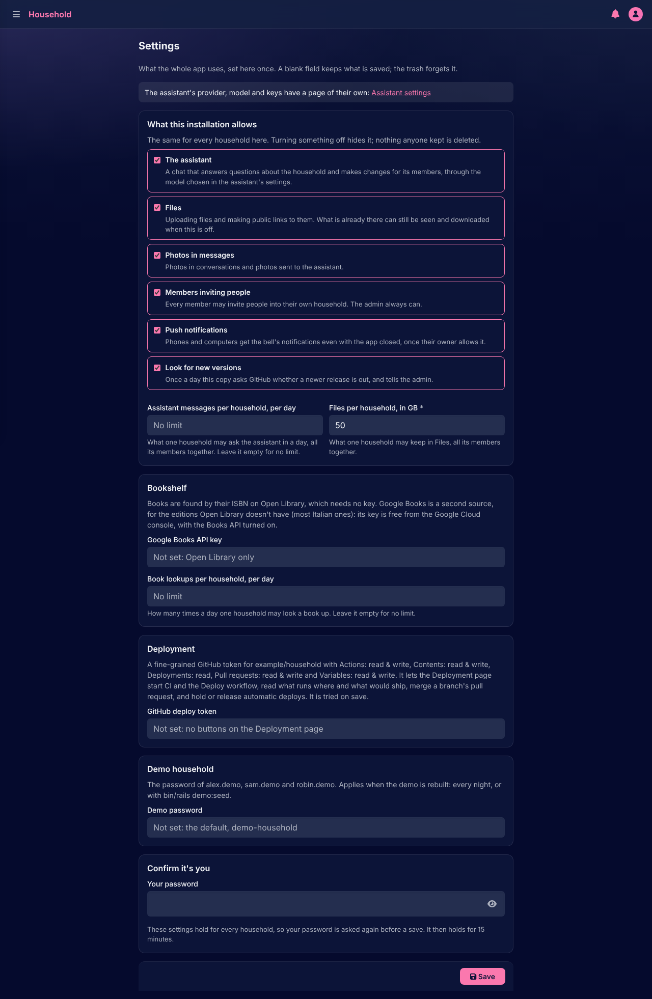
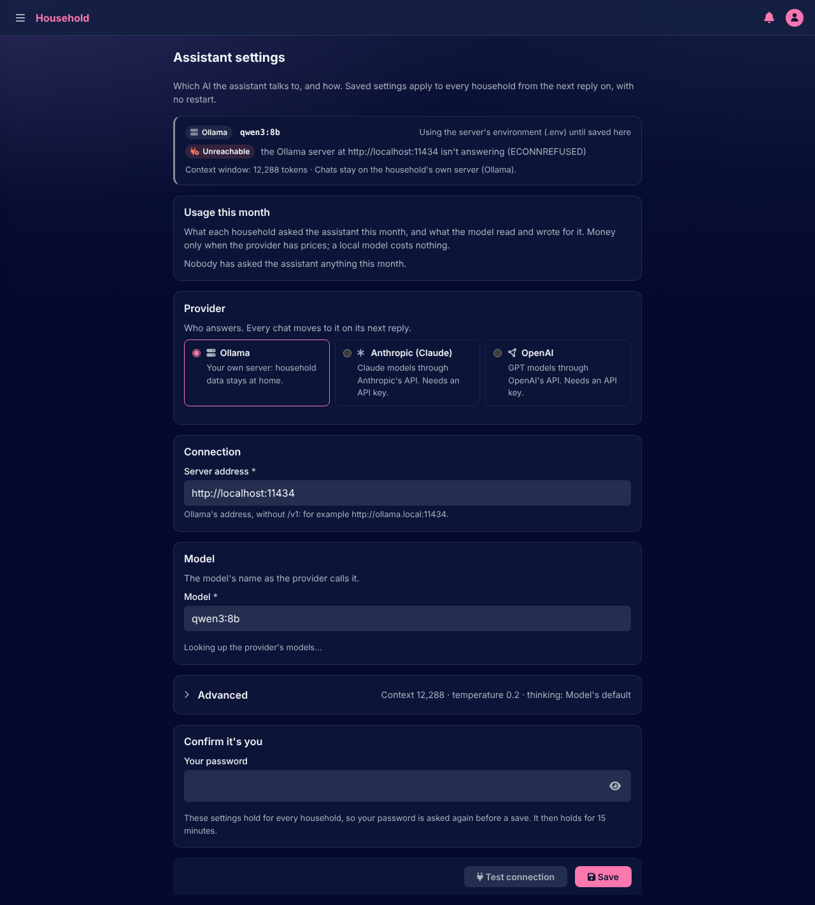

# Admin

[Documentation](../README.md) › [Guide](README.md)

The admin runs the copy: its households, its settings, the assistant's model, the assistant's languages, and the app's own health. The first account made on the setup page is the admin. The admin's pages are under **Admin** in the navigation, and nothing on them reaches into a household's records: the admin makes households, invites their first member, and helps a person back in, nothing more.

Anything the admin does to someone else's account, and every save of the settings, asks for the admin's password again, which then holds for a while.

## Households

Every person belongs to one household, and **Households** lists them with their members and the invitations waiting. **New household** asks its name and its first member's email: that person gets a link to join, shown once to hand over, becomes the household's owner and invites the others.

From a household's page the admin can also make a link for a member to set a new password, or remove a person. The admin's own forgotten password is never mailed: on the server, `bin/rails admin:password_link USERNAME=…` prints a link that works for 30 minutes (`household password-link <username>` on a copy of one's own).

## Settings

**Settings** holds what the whole copy uses, the same for every household, in the sections the setup page asked:

- **What this installation allows**: the assistant, Files and the storage per household, photos in messages, members inviting people, push notifications, looking for new versions, the assistant messages per household per day, the people per household and the invitations per member. Turning something off hides it; nothing anyone kept is deleted.
- **Bookshelf**: the Google Books key and the book lookups per household per day.
- **Mail**: whether the copy sends mail, the SMTP relay it goes out through (server, port, encryption, login, sender address), and its budgets: the mail per hour and per day for the whole copy, and the reminder mails per household per day. A relay field left empty follows the copy's environment, whose value it shows.
- **Deployment**: the GitHub token behind the Deployment page's buttons, on a copy that runs the pipeline.
- **Demo household**: the password of the demo accounts, where the copy runs a demo.

Every value here can be changed here. Where the copy's environment names one, that is only where it started, before anything was saved.

## Mail

**Mail** says whether mail goes out, and what stops it otherwise: turned off, a relay not set up, or a pause. When the relay refuses the copy's own settings, such as a wrong password, all mail waits for a quarter of an hour, the admin is told on the bell, and the page says what to fix and what the relay answered; **Send a test mail to me** in the top bar ends the pause and shows whether the fix worked. The page also shows the relay, what went out in the last hour and day against the budgets, what waits, and what couldn't go out in the last 30 days: whose it was, why, and what the relay answered, with any address masked. It never shows what a mail said.

## Assistant settings

**Assistant settings** picks who answers the assistant: an Ollama server by its address, or Anthropic or OpenAI by an API key, which is stored encrypted and never shown again. **Test connection** checks the key and lists the provider's models before saving; then the model's name, its context window, and under Advanced the temperature, thinking and the longest reply. A saved change applies to every household from the next reply on. The page also shows what each household asked this month, with the tokens read and written and the cost where the provider has prices.

## Languages

**Languages** is the dictionaries the assistant uses to understand the names of supplies and things in each language. Each language's words come from Wiktionary; an import runs in the background, is held for the admin's review when its cases need confirming, and is used only after its checks pass. The admin is told on the bell how each import ended.

## Errors and jobs

**Errors** lists every error the app reported, grouped by kind, with where it happened; **Jobs** is the background work: what is queued, running, finished or failed, and a failed job can be retried or discarded there. The admin is told on the bell, and by push, the first time a kind of error appears and when a job fails for good, at most once an hour for the same thing. An error only the admin can fix says what to fix.

## Evals

**Evals** runs the assistant's test scenarios against the model in use and keeps each run: how many passed, how long and how many tokens a scenario took, and which scenarios fail most. It is how a change of model or settings is judged before people meet it.

## Deployment

**Deployment** says what this copy runs: its version, environment, when it booted, and whether its database and job worker answer. On a self-hosted copy it also checks once a day whether a newer release is out and shows the command to update; on a copy that runs the repository's pipeline it is the delivery console, which previews a branch, merges it, promotes a version to production, rolls back, and shows the last runs and the delivery metrics.

---

How it works: [Tenancy](../architecture/tenancy.md), [Delivery](../architecture/delivery.md)

[← People](people.md)
