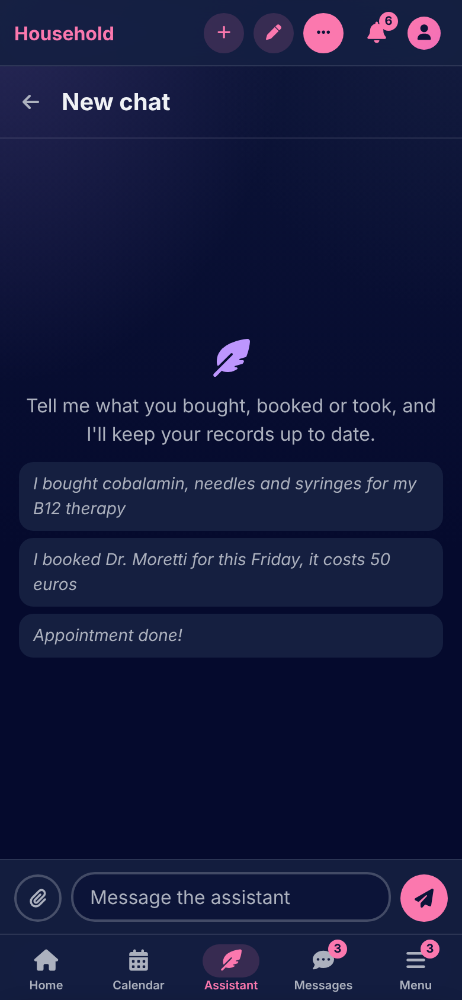

# The assistant

[Documentation](../README.md) › [Guide](README.md)

The assistant is a chat that files things for you. "I paid the plumber 80 in cash", "Cobalamin 250, the test was today", "I took my metformin", "Dinner at Marco's on Friday, it cost 45", or a photo of a lab report, and the records are saved where they belong on the calendar, in the pantry or on the shelf. It works with a small model running on your own machine, or with Anthropic's or OpenAI's.

## A chat

**Assistant** in the navigation opens your latest chat; **New chat** starts another, and the list keeps them all, each renamed or deleted from its menu. A message is up to 4000 characters and up to five photos (JPEG, PNG, WebP or HEIC, at most 10 MB each). The assistant answers in your language, and the reply can be stopped while it is being written.

The assistant reads only what you can see: your own records, what is shared with you, and what a linked housemate lets you see. It acts as you, with your permissions, so a change to a linked housemate's item where their grant says "ask" is held for their OK like any other request.

## What it files

It makes records of every kind: tasks, appointments, medications and doses, lab results and their values, payments, meals, supplies and their purchases, grocery purchases, ingredients, recipes, grocery lists, books, collections, analytes and reference ranges. It also updates a record, marks one done or not done, shares one with a housemate, deletes one, and merges two analytes that are the same thing. The dates, amounts and ranges in what you write are read by the app itself, so "a week ago" and "4.0–10.0" mean what you meant.

Each change is shown on a card in the chat as it is saved: what was made, on which day, and **Review** or **Edit** to open it in its own form. When something is missing or unclear, the card says so and the assistant asks for more details

## Your OK, and undo

Most changes are saved at once. A deletion, a merge, a share, a possible duplicate, or a change a housemate will see waits for your **Apply**, and the card names who will see it. **Cancel** drops it. Every change applied has an **Undo** on its card, which puts things back as they were, unless the record was changed afterwards; a deletion or a merge can't be undone.

## Photos of lab reports

Send a photo of a lab report and the text is read from it on the server, never by the model, and the values proposed as a lab result for you to check before they are saved. Photos can be turned off for the whole copy by the admin.

## Limits and privacy

The admin sets how many messages a household may send the assistant in a day; the composer says what is left. With Ollama the chat stays on the household's own server. With Anthropic or OpenAI, what you write, health data included, is sent to them to be answered, and the composer says so.

When the assistant can't answer, the chat says why: the model's server can't be reached, the provider has had too many requests, the chat has grown too long for the model and a new one is needed, or the assistant isn't set up right.

---

How it works: [The assistant](../architecture/assistant.md)

[← Messages](messages.md) · [People →](people.md)
