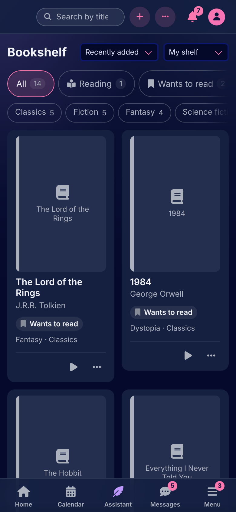
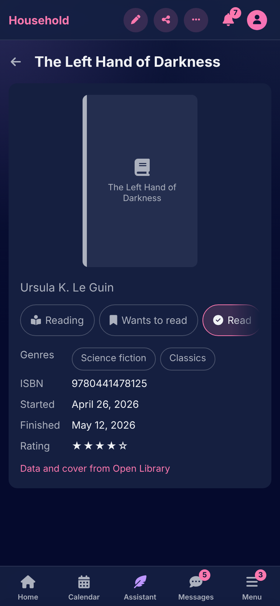

# The bookshelf

[Documentation](../README.md) › [Guide](README.md)

The Bookshelf is each member's books, as a grid of covers: what they want to read, are reading, have read or dropped. It is filled by scanning a barcode, by typing an ISBN, or by hand.

 

## Adding a book

**Scan a barcode** opens the phone's camera: hold the barcode on the back cover inside the frame, and the book is looked up and its form filled in. Without a camera, or where it isn't allowed, take a photo of the barcode or type the ISBN. **New book** opens the form straight away: type the ISBN and press **Look up**, or fill it in by hand.

A lookup asks Open Library, which needs no key, and Google Books where the admin gave a key, for the editions Open Library doesn't have, most Italian ones among them. It fills in the title, author, genres and cover for you to check before the book goes on the shelf, and says when the ISBN is unknown, the catalogue isn't answering, or the household has used its lookups for the day. A book already on your shelf is recognised. For a series, the form proposes the next volume after the last one on your shelf.

A book's form also holds its status, when it was started and finished, a rating from 1 to 5 and notes.

## Reading it

A book's status is **wants to read**, **reading**, **read** or **dropped**. Each card has one button for the next step: start reading, finished it, read it again, pick it up again, and "drop it" behind the menu. Finishing a book asks for a rating.

The shelf is filtered by status and genre, searched, and sorted by what was added last, title, author or last finished. **Whose shelf** shows your own, one housemate's, or everyone's.

## Sharing

A book is shared with a housemate from its card, or the whole shelf at once with **Share my shelf**: they then see every book on it, now and later. A shared book shows whose it is.

---

[← Pantry](pantry.md) · [Files →](files.md)
