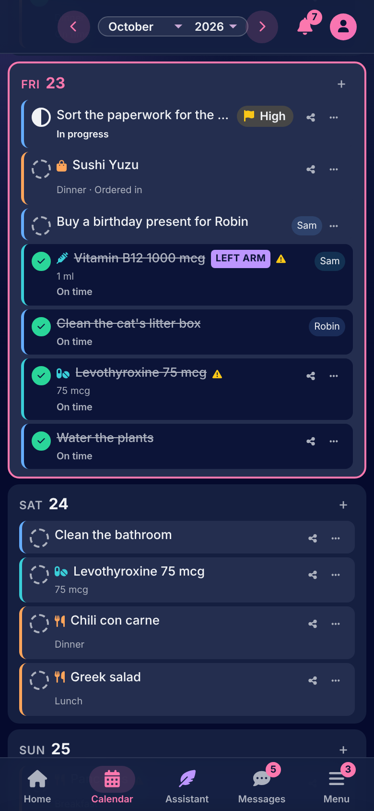
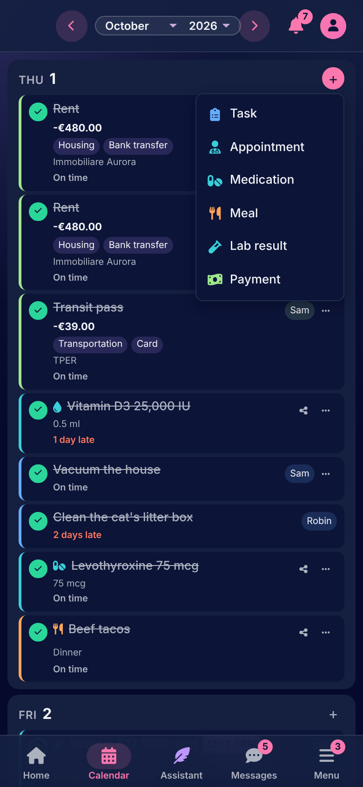
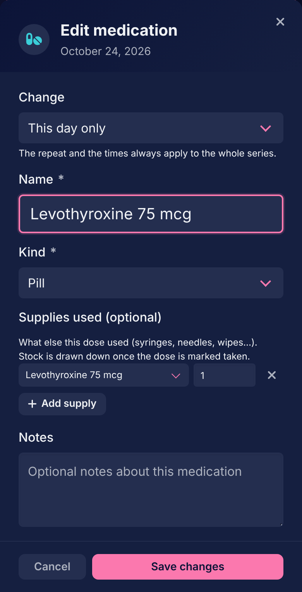
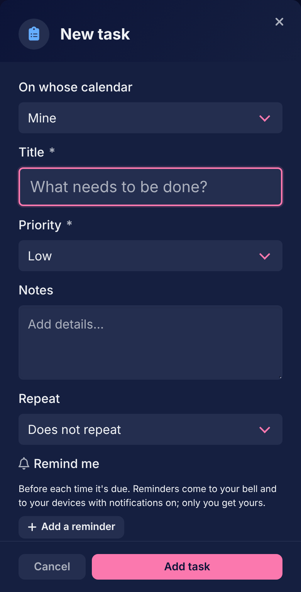

# The calendar

[Documentation](../README.md) › [Guide](README.md)

Everything the household plans is on the calendar: a month of day cards, each listing the day's items. Items are added, done and changed there.

 

## Series and days

Everything on the calendar is a **series** with its **days**. A task due on Friday is a series of one day. A medication with breakfast and at bedtime, every day, is a series whose days run on until it is stopped. The rent on the first of the month is a series too. You never make the days: the series' repeat rule makes them, and a day exists on the calendar before anything was recorded about it.

A day's form asks, when the series repeats, whether the change is for **this day only** or **the whole series**. A change to the series is from today on: a day already done is a record of what happened, and editing the series never rewrites it. The repeat rule and the times of day always belong to the whole series.

A series repeats daily, weekly on chosen days, monthly or yearly, every one or every few: "every 2 weeks on Monday and Thursday". A series that does not repeat is one day.

## The six kinds

The **+** on a day card offers the six kinds, and each has a form of its own. They share a title, notes, a status, the repeat rule, reminders and an optional collection.

| Kind | What is its own | A done day is |
|---|---|---|
| Task | A priority (low to urgent); a task can also be "in progress" | Done |
| Appointment | A kind (medical, work, social, personal, other), a time, a place, who it is with, and an optional cost | Attended |
| Medication | Its kind (pill, drops, injection, with area and side), how many times a day and when ("with breakfast", "at bedtime" or a time), the supplies each dose uses | Taken |
| Meal | Where (cooked at home, eating out, ordered in), which meal, the recipes it is made of, an optional cost | Eaten |
| Lab result | Its values, each an analyte, a number and a unit, flagged against the analyte's reference range | Recorded |
| Payment | An amount, expense or income, a category, who it was paid to or by, the payment method | Paid or Received |

Each kind belongs to a section, and its card carries that section's colour: tasks and most appointments to Agenda, medications, lab results and medical appointments to Healthcare, payments to Finance, meals to Pantry. Each section's page on Home has that kind's figures.

A cost on an appointment, a meal or a purchase is a payment of its own on the calendar, attached to the thing it paid for, with its title, kind and category filled in. It is marked paid from the thing's card or from its own.

 

## What happens to a day

The circle on a card marks the day done, in its kind's own word, and a second press takes it back. A day marked done late or early says so on its card. The day's form sets any status: pending, done, **skipped** or **cancelled**; a task can also be in progress, and a skipped dose asks why (refused, not available, held on advice, forgot, another reason) and a taken one when.

A day that passes with nothing recorded is a day missed, and Home lists it under Needs attention until something is recorded or it is marked skipped. Cancelled days count nowhere.

Tapping a card's title opens the day's form. The share icon beside it shares the series with a housemate, and the card's menu holds **delete this day** and **delete the whole series**. Deleting a series removes every day of it, done ones included, and asks first.

## Reminders

Any series can have reminders: a number of hours or days before each time it is due. They come to your bell, and to the devices where you turned notifications on. Reminders are yours alone, even on a series shared with you.

## Collections

A collection keeps related series together: a therapy in Healthcare (its appointments, medications and lab results), a job hunt in Agenda, a renovation in Finance, a party in Pantry. A series is put in one from its form, and a collection's page lists everything in it. A collection is active, paused or completed, and can be shared whole. Deleting a collection leaves its series on the calendar.

## Someone else's days

A day someone shared with you, or that you see through a link between your calendars, shows whose it is on its card. What you may do with it depends on how it reached you: a shared series can be changed by whoever it was shared with; a linked one does what its owner allowed, kind by kind, and may need the owner's OK first. [People](people.md) explains both.

---

How it works: [The calendar](../architecture/calendar.md)

[← Home](home.md) · [Finance →](finance.md)
