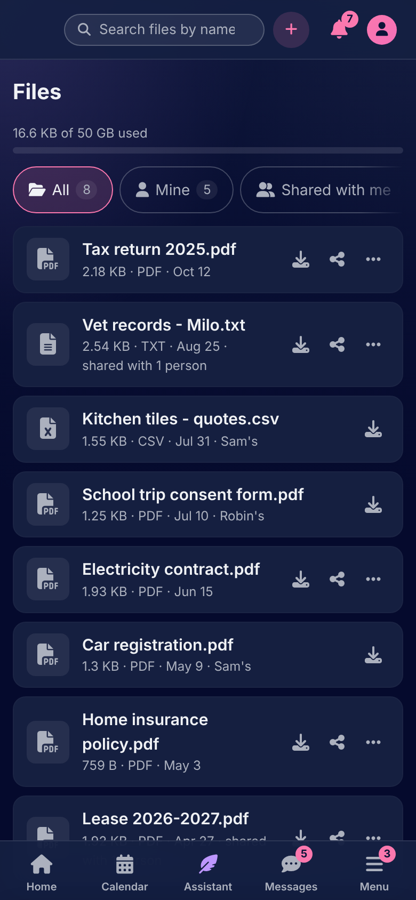
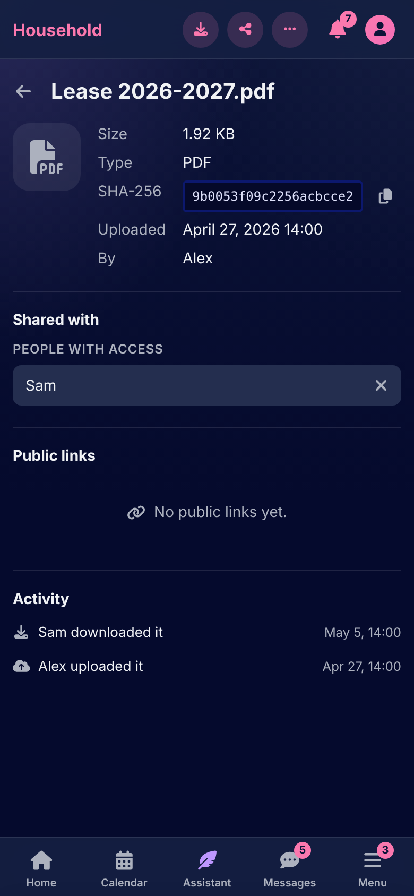

# Files

[Documentation](../README.md) › [Guide](README.md)

Files is the household's storage for files of any kind and size: pdf, image, video, archive and so on. A file is private to whoever uploaded it until it is shared with a housemate or handed out by a public link, and everything that happens to it is on its trail.

 

## Uploading

**Upload files** opens the uploader: drop files on it or tap to choose. Big files are fine: they go up in pieces of 16 MB and pick up where they left off after a dropped connection, with the progress, speed and time left shown for each. A phone pauses uploads while the browser is in the background and goes on by itself when you come back; closing the screen stops them, and a file half up is resumed when you choose it again. Each upload can be paused, resumed or cancelled.

The page shows how much of the household's storage is used. The admin sets what a household may keep, and whether anything new may be uploaded at all; what is already there is always seen and downloaded. A file is at most 50 GB.

A file's row says its kind (image, video, audio, PDF, archive, spreadsheet, presentation, document, text, or just a file), its size, who uploaded it and whether it is shared. Its page adds its SHA-256 checksum, to copy, and the trail. A file is renamed from its page, and deleted: every share and public link to it stops working.

## Sharing with a housemate

**Share** on a file picks a housemate, who can then see and download it, and is told on their bell. The file's page lists who it is shared with, and sharing is stopped there. The Files page is filtered to all files, mine, or shared with me.

## Public links

A public link lets someone with no account download one file. **Make a public link** asks how long it is good for (1, 7 or 30 days), how many downloads it allows (1, 5 or no limit), and an optional password of at least 8 characters, which you tell the person separately. The link is shown once, right after it is made: copy it then.

Whoever opens it sees the file's name, its size, who shared it and what is left of the link, and presses Download. A download cut short can be taken up again without spending the link. After ten wrong passwords the link closes itself. The file's page lists its public links, each active, used up, expired or revoked, and revokes one at any time.

## The trail

A file's page keeps every event in its life: who uploaded it, who it was shared with and when sharing stopped, who downloaded it, each public link made or revoked, and each download, refusal or lock-out by public link, with the address it came from.

---

How it works: [Files](../architecture/files.md)

[← The bookshelf](bookshelf.md) · [Messages →](messages.md)
