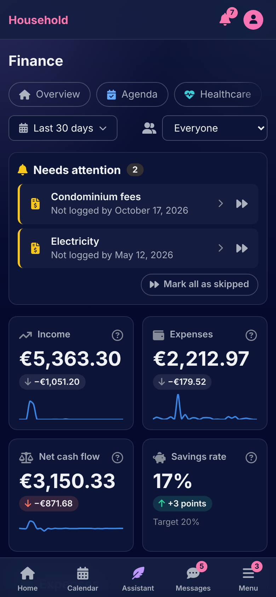
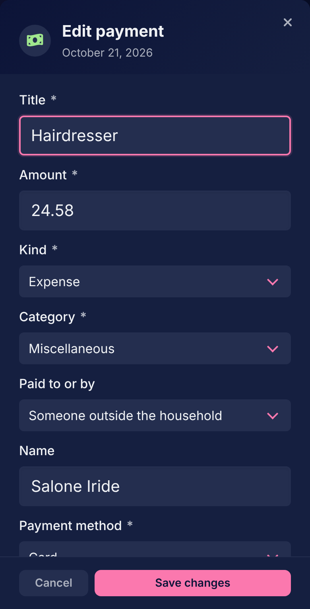
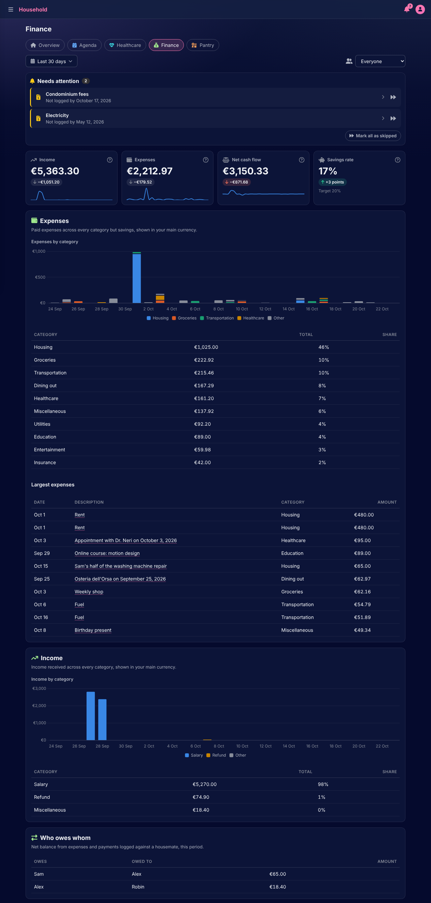

# Finance

[Documentation](../README.md) › [Guide](README.md)

Finance is the household's money: payments on the calendar, and the Finance page on Home that adds them up.

  

## Payments

A payment is a series on the calendar like any other, so a one-off bill and the rent on the first of every month are made the same way. Its form asks:

- **Amount**, in the household's currency, with no sign: the kind carries the direction.
- **Kind**: an expense or income.
- **Category**: salary, freelance, bonus or refund for what comes in; housing, utilities, groceries, dining out, transportation, healthcare, education, entertainment, shopping, insurance, taxes, savings, debt or miscellaneous for what goes out.
- **Paid to or by**: a name, for someone outside the household, or a housemate.
- **Payment method**: card, cash or bank transfer, or not said.

A payment's day is marked **Paid**, or **Received** for income, from its card. A payment whose day passed unmarked is on Home under Needs attention, "not logged by" its day.

## Payments between housemates

A payment to or from a housemate is one payment with two readers. For the one who pays it is an expense; for the one who is paid it is income, on their own calendar, with the same amount and day. Each marks it from their own side, and there is never a copy to keep in step. The Finance page's **Who owes whom** adds these up into a balance per pair of housemates.

## Costs attached to other things

An appointment, a meal, a supply purchase or a grocery purchase can carry a cost. Filling in the cost section of its form makes a payment on the calendar attached to it, with its title, kind and category already set: healthcare for an appointment with a provider or a supply, groceries for a grocery purchase. It is marked paid from the thing's own card or from the payment's. Deleting the thing leaves its payment on the calendar, no longer attached.

## The Finance page

The Finance page on Home has four headline figures for the period chosen: income received, expenses paid, net cash flow and savings rate. Money moved to savings is neither income nor an expense; the savings rate is what went to savings divided by income. Pending, cancelled and skipped payments count nowhere.

Its reports are expenses by category with the largest ones, income by category, and who owes whom. Everything is shown in the household's currency, and a figure that also holds other currencies says so beside it: amounts are never added across currencies.

## Collections

Payments that belong together, a renovation or a trip, go in a Finance collection, from the payment's form. The collection's page lists them all.

---

[← The calendar](calendar.md) · [Healthcare →](healthcare.md)
