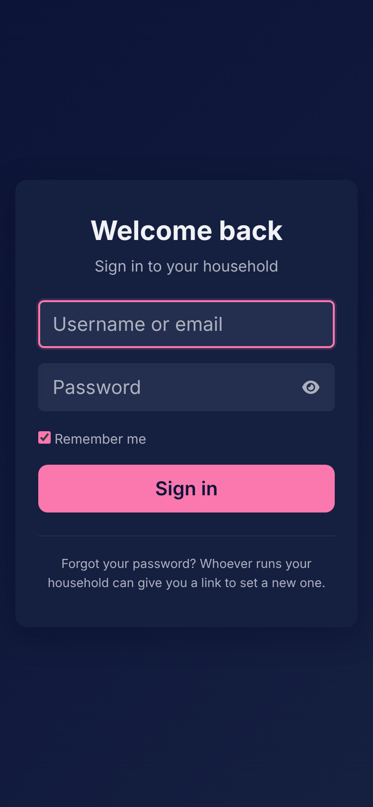

# First setup

[Documentation](../README.md) › [Guide](README.md)

Nobody can sign up to Household. The first person sets the copy up once, and everyone else comes in by invitation. This page is the first hour: the setup code, the setup page, inviting the others, and what each person does on their first visit.

## The setup code

A fresh copy shows its setup page to everyone who opens it, so a code keeps a stranger from making the first account before you do. The code is printed where the copy was installed: at the end of `install.sh` for a self-hosted copy, or by the development server when it starts. The app keeps only a digest of it, and it stops working as soon as the first account exists.

The setup page asks for the code first and shows no form until it is right. Lost it? On a self-hosted copy, `~/household/household setup-code` makes a new one, and on a development machine `bin/rails setup:code` does. Neither works once someone has an account.

## The setup page

Everything the copy needs is asked once, a step at a time, and saved all together when you press **Create the household**. Until then nothing is saved, and **Back** goes to the step before.

1. **You.** Your name, username, email and a password of at least 12 characters, and the language the app speaks to you. This account runs the app: it is the household's first member and the copy's admin.
2. **Your household.** Its name and its currency, a three-letter code such as EUR. Payments and the Finance page count in it.
3. **What this installation allows.** The switches and limits that hold for every household on this copy: the assistant, Files and the room each household gets, photos in messages, whether members may invite people, how many people a household may hold and how many each member may invite, push notifications, and whether the copy looks for new versions once a day. Everything is on and unlimited until you say otherwise, and nothing here deletes anything later.
4. **The assistant.** Which model answers: an Ollama on your own machine, or Anthropic or OpenAI with a key. **Test connection** checks the key and lists the provider's models before anything is saved. The assistant is optional; everything else works without it.
5. **Bookshelf.** An optional Google Books key, for the editions Open Library doesn't have, and how many lookups a household gets in a day.
6. **Mail.** Whether the copy sends mail, and the SMTP relay it goes out through: its server, port, encryption, login and the sender's address. Mail is what lets people have their reminders by email and ask for a link when they forget their password. Without a relay the copy mails nothing and everything else works.
7. **Who else lives here.** As many people as the limits from step 3 allow, each by email and first name. Each gets an invitation link, shown once at the end: nothing is emailed, you hand the link over yourself. You can also invite people later.

The last step shows everything as it will be saved, with a **Change** link back to each step. After **Create the household** you are signed in, and the invitation links are on screen to copy. Every answer can be changed later: the installation's settings and the mail on the admin's Settings page, the assistant on its own settings page, the people on the Household page.

## Inviting the others

The Household page, under your name in the top bar, lists the household's people and its invitations. **Invite someone** asks their email and first name and shows the link once; whoever invited them, or the admin, can make a new link when it expires or take the invitation back. How many people a household holds, invitations still waiting included, and how many each member may invite are the admin's to set; with no number set there is no limit. Lowering either removes nobody: a household over the limit just can't invite until someone leaves. The admin can also turn members' invitations off for the whole copy, and then invites people alone.

Whoever opens the link chooses their own username and password and is in, with the standard analytes and a place in the household's conversation from the start. Nobody can share anything with a person whose invitation is still waiting.

## Signing in

Sign in with your username or your email. **Remember me** keeps you signed in on that device. A refused sign-in never says whether the account exists.

If you forget your password and the copy sends mail, **Forgot your password?** under the sign-in form asks for your username or address and mails a link to set a new one, which works for 30 minutes. It goes only to an address you confirmed on your Account page, and the page says the same whatever you type, so nobody learns from it who has an account. Otherwise, the household's owner (its first member) or the admin makes you a link from the Household page, and the app tells you at once on your bell that a link was made. Whoever opens such a link can sign in as you, so if you didn't ask for one, say so right away.

The account this setup makes gets neither: no link is mailed to the admin, and nobody makes one for themselves. Its way back is the machine the copy runs on, where `household password-link <username>` on a copy of one's own, or `bin/rails admin:password_link USERNAME=…` in the app's container, prints a link that works for 30 minutes.

## Your account

**Account**, on the account menu in the top bar, holds your address and your password. Where the copy sends mail, **Mail me a link to confirm it** confirms the address: the link opens a page that asks for your password and a press, since mail scanners open links by themselves and a confirmed address is where a link to set your password goes, for everyone but the admin. A new address takes over only once its own link is pressed, and your confirmed address hears of the change first. Changing your password asks for the one you use, signs you out everywhere else, and tells the address confirmed at the time.

## Language and time zone

The app speaks English or Italian. Each person picks their own, on the account menu in the top bar, and it also sets the language the assistant answers in.

Days are your days: the app reads your time zone from your browser and keeps it, so a reminder "3 hours before" and today's list follow the clock where you are.

---

[← The guide](README.md) · [Home →](home.md)
