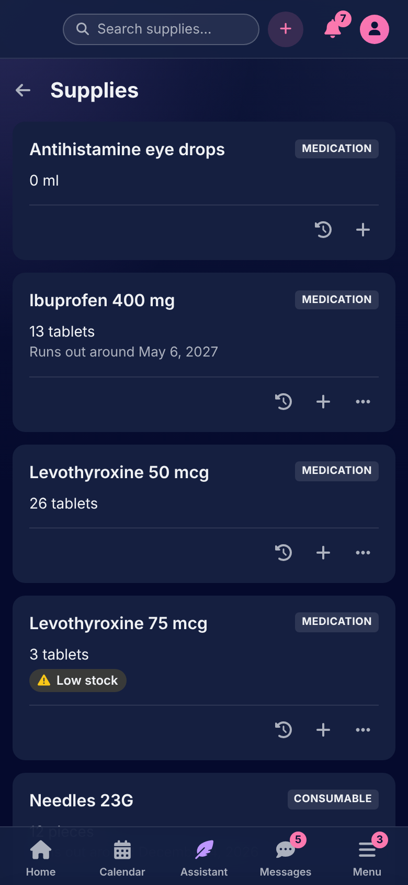
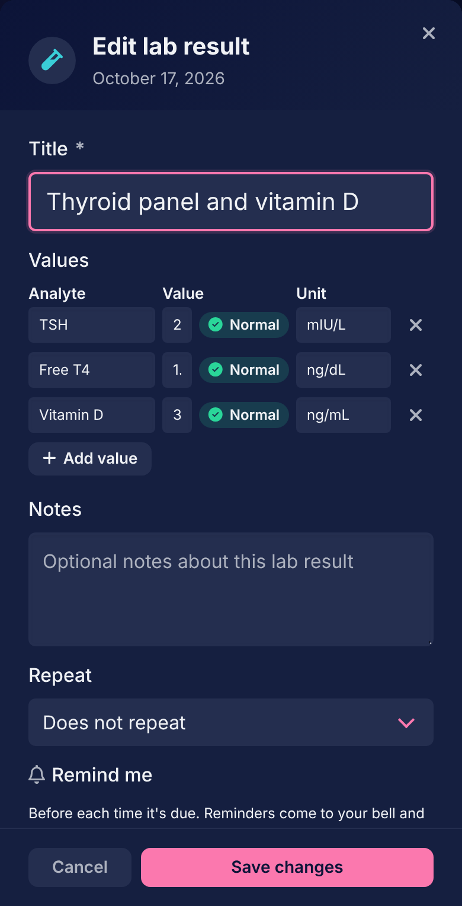
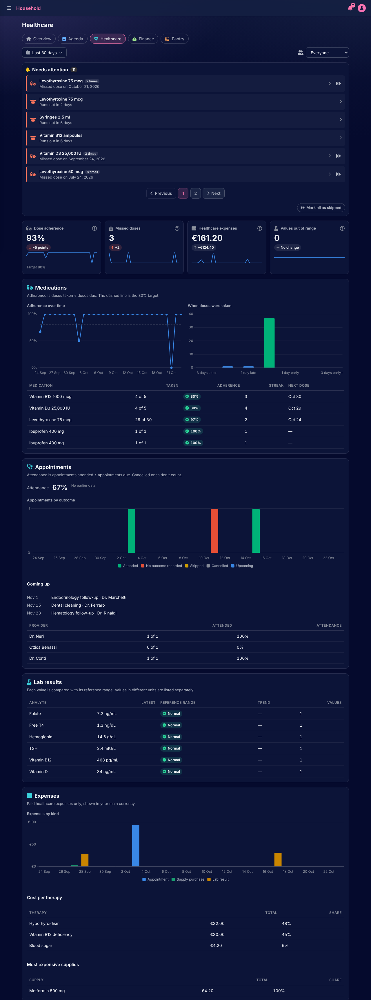

# Healthcare

[Documentation](../README.md) › [Guide](README.md)

Healthcare is medications, medical appointments and lab results on the calendar, the therapies that group them, the analytes a lab result is measured in, and the supplies a therapy uses up. Its page on Home has adherence, missed doses, healthcare expenses and the values out of range.

 

## Medications

A medication is a series on the calendar whose days are doses. Its form asks the name, the kind (a pill, drops or an injection, with the area and the side: left thigh, right arm), and the **times**: how many a day, each "with breakfast", "with lunch", "with dinner", "at bedtime" or at a set time. Left at none, it is one dose a day with no set time. A series taken three times a day has three doses on each day card, and each is marked on its own.

A dose is marked **Taken** from its card. Its form also records when it was taken, or that it was **skipped** and why: refused, not available, held on advice, forgot, or another reason. A dose whose time passed is on Home under Needs attention until it is marked. Skipped and missed doses both count against adherence.

**Supplies used.** A dose can use supplies besides the medication itself: a syringe, a needle, a wipe, each with a quantity. Stock is drawn down when the dose is marked taken, and the card warns when a supply is running low.

## Therapies

A therapy is a collection in Healthcare: its appointments, medications and lab results kept together. **Medical therapies**, in the navigation, lists them; a new one is started there, and a series is put in one from its form. A therapy is active, paused or completed, can be shared whole with a housemate, and has a cost on the Healthcare page, from the payments attached to what is in it. Deleting a therapy leaves its series on the calendar.

## Medical appointments

An appointment whose kind is medical belongs to Healthcare: its provider, time, place and notes, and an optional cost, which becomes a healthcare payment attached to it. It is marked **Attended** from its card. One that was on a past day with no outcome recorded is on Home under Needs attention.

## Lab results

A lab result is a day on the calendar with **values**: each an analyte, a number and a unit, as many as the report holds. A value is flagged against the analyte's reference range: **Normal**, **Low**, **High**, or **Abnormal** past the critical bounds. A card with any value out of range says so. A lab result is marked **Recorded** once its values are in; one that was on a past day without values is on Home under Needs attention.

The assistant reads a photo of a lab report and proposes its values, which you check before they are saved: see [the assistant](assistant.md).

### Analytes and reference ranges

An analyte is what a value measures: cobalamin, ferritin, glucose. Every member starts with the standard ones, and **Analytes** in the navigation lists them; a new one can be typed straight into a lab result's form, or added there. An analyte can't be deleted while a lab result uses it.

An analyte's page holds its **reference ranges**, one per unit: a low and a high bound, optional critical bounds past which a value is flagged Abnormal rather than Low or High, and who it applies to: everyone, men or women. A value takes the range for its unit and for the person when there is one, else the one for everyone. Without a range, values show no flag.

## Supplies

A supply is something a therapy uses up: a medication's own stock, or a consumable such as needles. **Supplies** in the navigation lists them, each with what is in stock and, once the app has seen how fast it goes, when it runs out. Its form asks the name, the category (medication or consumable), the stock unit, the **low-stock threshold**, and how many days it keeps once opened.

Stock comes in by **purchases**. Each purchase is a batch: the quantity, the day it was bought, its expiry date, the day it was opened, and an optional cost, which becomes a healthcare payment attached to it. A batch expires on the date printed or the opening day plus the days it keeps, whichever comes first. **Purchase history** on a supply lists its batches, what is left of each, and which has expired. A supply running out, under its threshold, or holding an expired batch with stock left is on Home under Needs attention.

A supply can't be deleted while a medication uses it. Deleting one with purchases deletes them too; their payments stay on the calendar, no longer attached.

## The Healthcare page

Four headline figures for the period: dose adherence (doses taken divided by doses due, with the 80% target drawn on the chart), missed doses, healthcare expenses paid, and values out of range, with how many are past the critical range. The reports are adherence per medication with its streak and next dose, when doses were taken, medical appointments by provider, the latest value per analyte with its trend, expenses by kind, per therapy and by supply, and the supplies: days of stock left, what to reorder, and the batches expiring.

---

[← Finance](finance.md) · [Pantry →](pantry.md)
