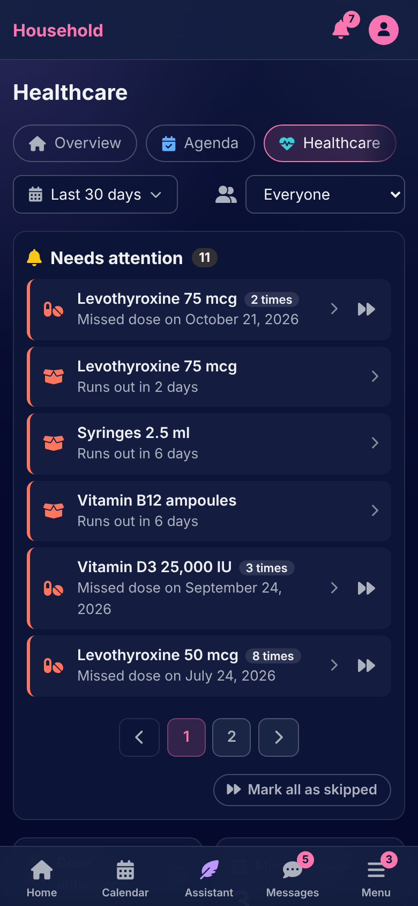
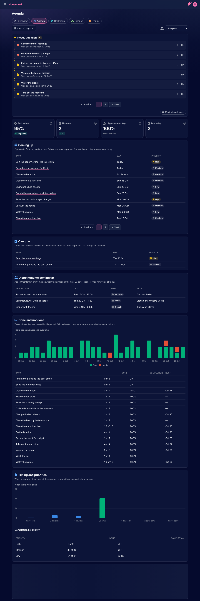

# Home

[Documentation](../README.md) › [Guide](README.md)

Home shows what needs attention, what is due today, and one page per section with its figures. A row opens the item in place, and each figure has a hint saying what it counts.

 

## The overview

The first page is the overview. At the top, **Needs attention**: the things that went past their day without a word, each with why it is here. A dose due hours ago and not taken, a dose skipped and why, an appointment that was on Tuesday with no outcome recorded, a lab result still without values, a payment not logged by its day, a task that was due, a meal planned for a day short on ingredients or never marked eaten, a supply running out or already under its low-stock threshold, a batch expiring or expired with stock left, a lab value past its critical range. Urgent ones come first.

Each row has a way to settle it: open the item and record what happened, or **Mark as skipped** when there is nothing to record. **Mark all as skipped** clears the list in one press; what was never recorded stays so, as skipped.

Under it, **Today** lists the day's items, then four cards, one per section, each with its headline figure: tasks done today, dose adherence over the last 30 days, net cash flow over the last 30 days, meals planned for the week. **Next 7 days** is what is still to do from tomorrow on, the most important first.

A household that has nothing yet sees two buttons instead: open the calendar, or invite your housemates.

## The section pages

Agenda, Healthcare, Finance and Pantry each have a page. Every one has the same shape:

- **Needs attention**, for that section alone.
- **Headline figures**, each with a hint saying exactly what it counts. A figure is compared with the period before it, and a target, where there is one, is drawn on the chart as a dashed line.
- **Reports**: tables and charts for the period.

Two controls at the top apply to the whole page. **Period** is the last 30 days, the current month, the previous or next month, the current year, or any two dates. **Whose data** is everyone in the household, or one person. The lists of what is coming up or overdue are always as of today, whatever period is chosen.

### Agenda

Tasks done, not done, due today and in the next 7 days, and appointments kept. The reports are the tasks coming up, the tasks overdue from the last 30 days, the appointments coming up in the next 30 days, done and not done over time, when tasks were done against their planned day and how each priority keeps up, and appointments by outcome. Medical appointments belong to Healthcare and are not counted here.

### Healthcare

Dose adherence, missed doses, healthcare expenses and lab values out of range. The reports are adherence per medication with its streak and next dose, when doses were taken, appointments by provider, the latest value of each analyte against its reference range with its trend, expenses by kind and per therapy, and the supplies: days of stock left, what to reorder, and the batches expiring.

### Finance

Income, expenses, net cash flow and savings rate. Money moved to savings is neither income nor an expense: the savings rate is what went to savings divided by income. The reports are expenses by category and the largest ones, income by category, and **Who owes whom**: the balance between housemates from the payments logged against each other.

### Pantry

Meals planned for the week, meals eaten as planned, items still to buy and grocery expenses. The reports are the meals short on ingredients in the next 7 days, the active grocery lists, meals against the plan by kind of meal, and what the household buys most often.

Every amount is shown in the household's currency. A figure that holds amounts in another currency says so beside it; amounts are never added across currencies.

---

How it works: [Dashboards](../architecture/dashboards.md)

[← First setup](first-setup.md) · [The calendar →](calendar.md)
