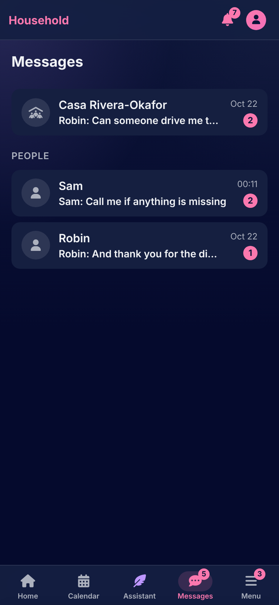
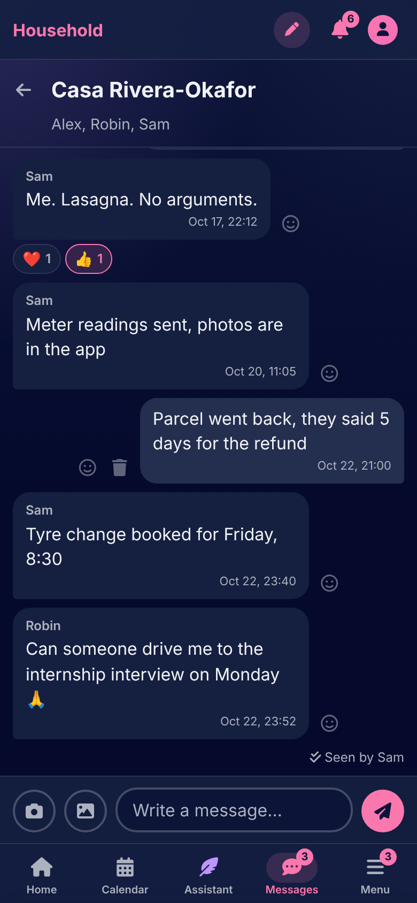

# Messages

[Documentation](../README.md) › [Guide](README.md)

Messages is where the household talks: one conversation for everyone, and one between any two housemates. Messages arrive live.

 

## Conversations

The household's conversation holds everyone and carries the household's name until someone renames it, which everyone sees. A conversation with one housemate is started from the **People** list on the Messages page, and is just the two of you. The Messages page lists them all with the last thing said and how many messages are unread.

## Writing

A message is words, up to four photos, or both. Photos come from the phone's camera or its library, and are kept without their location and device data; the conversation shows a small version and the original on a tap. A link in a message is clickable, and nothing else is interpreted. A message sent twice by a bad connection arrives once.

**Unsend** removes a message for everyone, leaving "Message unsent" in its place. A reaction is an emoji under a message: each person's once per emoji, from the picker on the message's smile, and a second tap takes it back.

The conversation says who has seen it: **Seen** under your last message, with the names where there are several.

---

How it works: [Messages](../architecture/messages.md)

[← Files](files.md) · [The assistant →](assistant.md)
