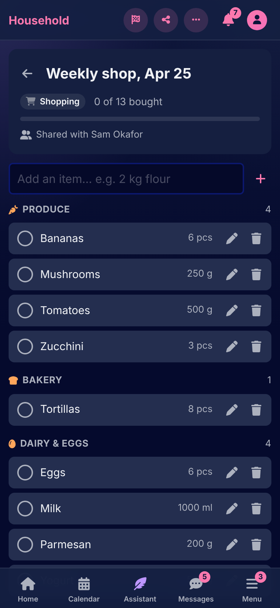
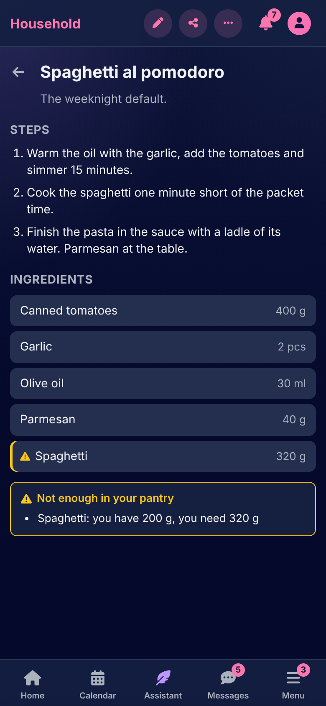

# Pantry

[Documentation](../README.md) › [Guide](README.md)

Pantry is what the household eats and buys: the ingredients on hand, the recipes, the grocery lists, and the meals on the calendar. Its page on Home has the meals planned for the week, the meals eaten as planned, the items still to buy and the grocery expenses.

 

## Ingredients

An ingredient is something the pantry holds: flour, eggs, olive oil. **Ingredients** in the navigation lists them, each with its quantity on hand and unit, and the store section it is found in (produce, dairy and eggs, meat and fish, bakery, dry goods, frozen foods, drinks, household, other). An ingredient can be typed straight into a recipe's or a grocery list's form, and it is made the first time it is named.

Stock moves on its own: a grocery list finished puts what was bought into the pantry, a purchase logged on the ingredient adds to it, and a home-cooked meal marked eaten takes its recipes' ingredients out. **Purchase history** on an ingredient lists what was bought and when; a purchase can carry a cost, which becomes a groceries payment on the calendar attached to it. An ingredient can't be deleted while a recipe or a grocery list uses it.

## Recipes

A recipe is a name, a description, its **steps** and its **ingredients**, each with a quantity and a unit. A recipe's page says when the pantry can't cover it: which ingredient is short, out, or not in the pantry at all, and how much the recipe needs. A recipe can be shared with a housemate, who can then cook from it and change it.

## Grocery lists

A grocery list is named, then filled on the list itself: type an item above it, "2 kg flour", and it is on the list with its quantity and unit read from what you typed; an item is also edited by hand, with its store section. The list is **shopped**: each item goes into the basket with a tap and comes out again; the page counts what is bought of the total. **Finish shopping** closes the list, and everything bought with a quantity goes into the pantry as stock. A finished list can be shopped again: everything goes back on it, and what was bought stays in the pantry.

A list is shared with a housemate, who shops from it and changes it; the household's active lists are on the Pantry page with what is left to buy on each.

## Meals

A meal is a series on the calendar: breakfast, lunch, dinner or a snack, **cooked at home**, **eating out** or **ordered in**. A home meal is made of recipes, as many as it takes, and its name defaults to theirs; eating out and ordering in ask a name and can carry a cost, which becomes a dining-out payment attached to the meal. A meal is marked **Eaten** from its card, and a home meal eaten takes its recipes' ingredients out of the pantry.

A meal's card warns when the pantry is short on what its recipes need, and Home lists the meals of the next 7 days that are short, and the meals that passed without being marked eaten.

## The Pantry page

Four headline figures: meals planned for today and the next 7 days, meals eaten as planned in the period, items not yet bought on the active lists, and grocery expenses paid. The reports are the meals short on ingredients, the active grocery lists, meals against the plan by kind of meal, grocery expenses over time, and what the household buys most often.

## Collections

Meals that belong together, a party or a diet, go in a Pantry collection, from the meal's form.

---

[← Healthcare](healthcare.md) · [The bookshelf →](bookshelf.md)
