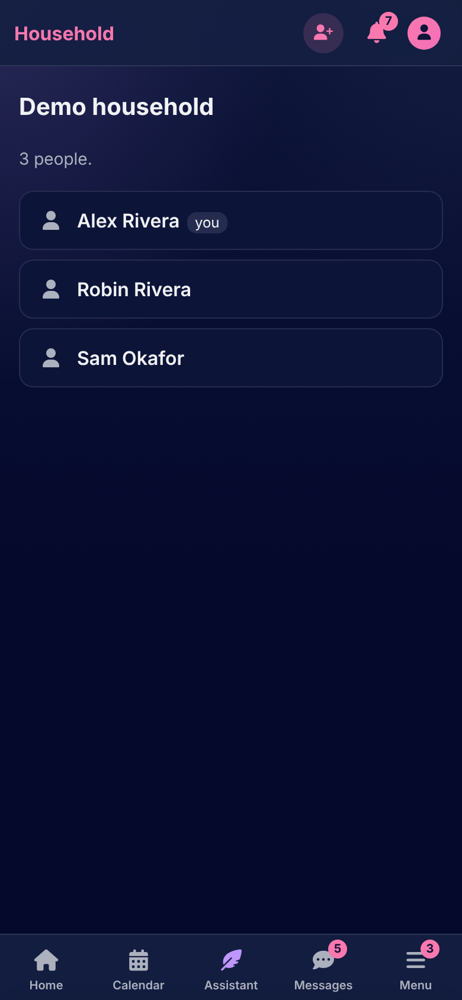
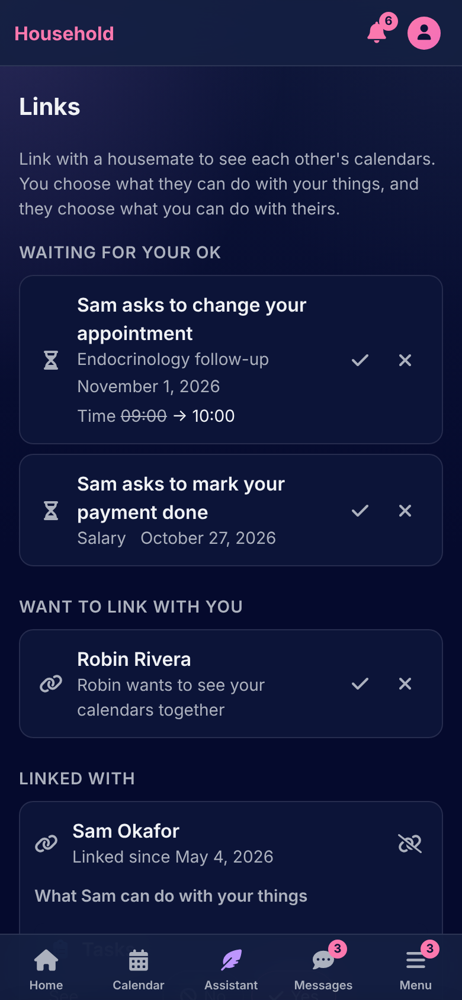
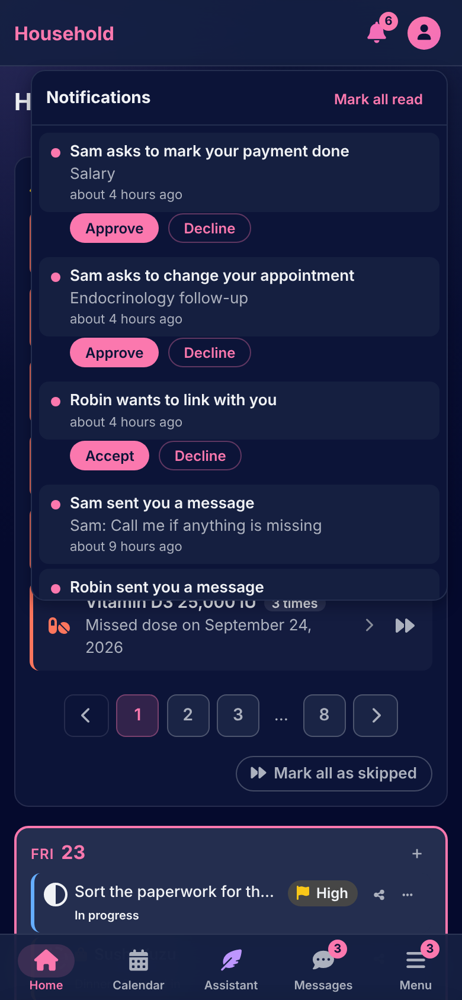

# People

[Documentation](../README.md) › [Guide](README.md)

A household is the people who live together. Each person's things are their own until they share one, or link their calendar with a housemate's. Nothing ever crosses from one household to another.

 

## The household

The Household page, on the account menu, lists everyone with who invited them and the invitations still waiting, and holds **Invite someone**. The household's first member is its **owner**: the owner, and the app's admin, can remove a person, with everything they kept, and make a link for someone to set a new password. Whoever invited a person renews or cancels their invitation while it waits. The admin may set how many people a household holds and how many each member may invite, and can turn members' invitations off for the whole copy.

Removing a person deletes what they kept, and unlinks what others kept about them: a payment with them stays on the other side, a shared recipe stays with its owner.

## Sharing a thing

A series on the calendar, a collection, a recipe, a grocery list, a book, a whole bookshelf or a file is shared from its **Share** button, with one housemate at a time. Whoever it is shared with sees it where it belongs and, for a series, a recipe or a list, can change it; they are told on their bell, and again when sharing stops. A shared thing shows whose it is. Sharing is one way, and the owner alone deletes.

## Linking calendars

Two housemates can **link**: one invites, from the Links page, and the other accepts or declines, there or from the bell. Linked, each sees the other's calendar, as far as the other allows.

On the Links page each sets, for each kind of item (tasks, payments, appointments, medications, meals, lab results), what the other may do with theirs:

| Action | Choices |
|---|---|
| See | no, yes |
| Edit | no, ask me, yes |
| Add to my calendar | no, ask me, yes |
| Delete | no, ask me, yes |

"See" off hides the kind altogether. When a link is accepted, seeing is on and the rest is "ask me". The other person is told when a setting changes. An item shared outright outranks the link: it can be changed without asking.

A linked housemate's day shows their name on its card. Where they may only see, the form opens read-only; where they may add, the new item's form asks **On whose calendar**.

## Ask me: a change that waits

Where a setting says "ask me", the change isn't refused: it is held as a **request**. The form says who will be asked, and the owner is told on the bell and on the Links page, under **Waiting for your OK**, where they **Approve** or **Decline**. Approving does the change exactly as if the owner had made it. The request says when the day changed since it was asked about, and the asker can **withdraw** it while it waits; a request expires after 30 days, and is cancelled when the owner deletes what it is about. The asker is told how it ended.

**Unlink** from the Links page ends it: each stops seeing the other's calendar, and requests waiting between them are cancelled.

---

How it works: [Tenancy](../architecture/tenancy.md), [Sharing and links](../architecture/sharing-and-links.md)

[← The assistant](assistant.md) · [Admin →](admin.md)
